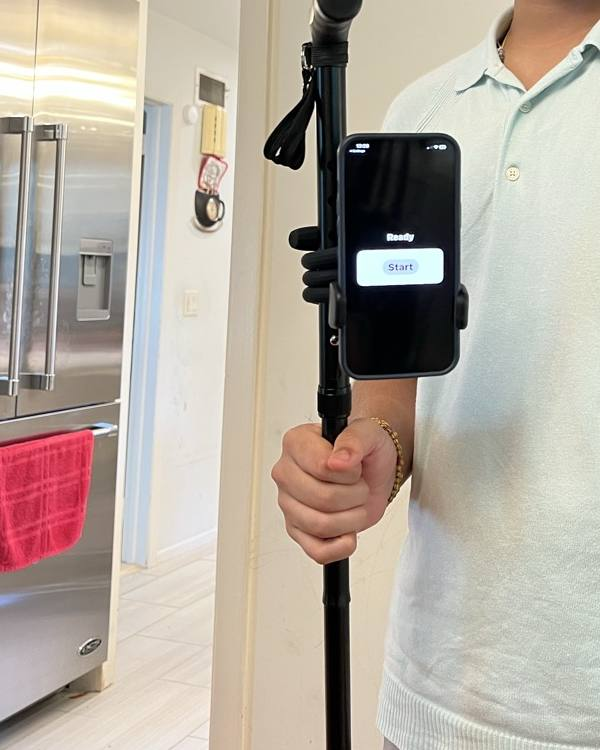
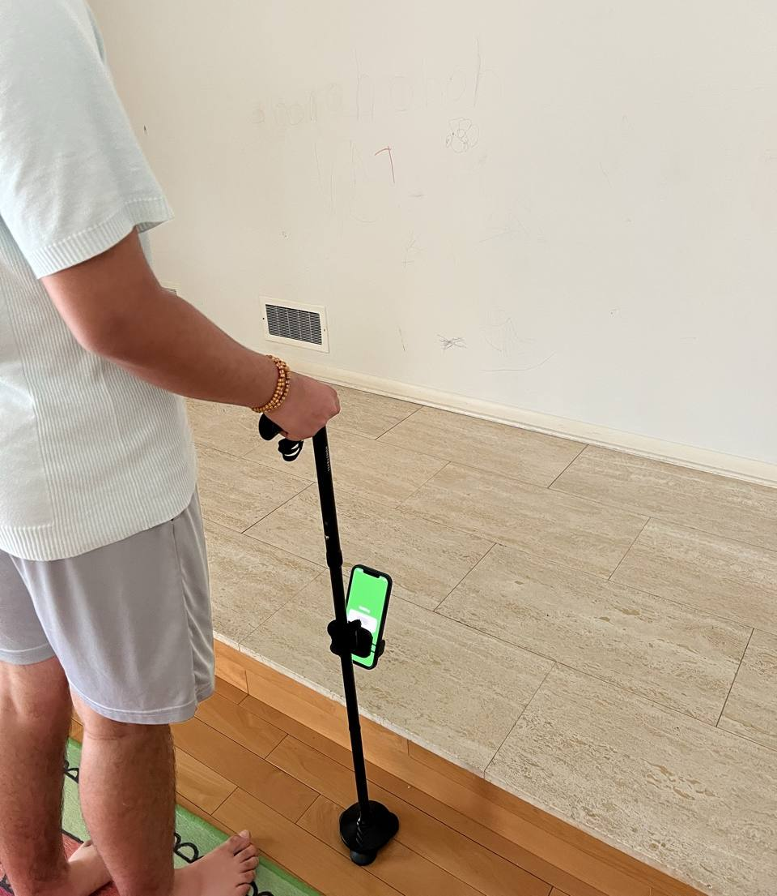
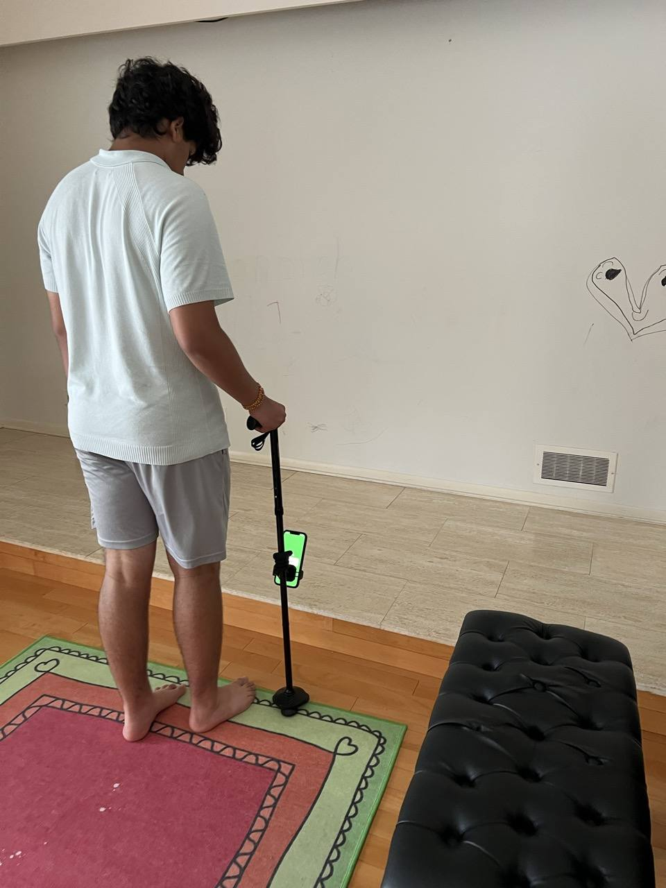
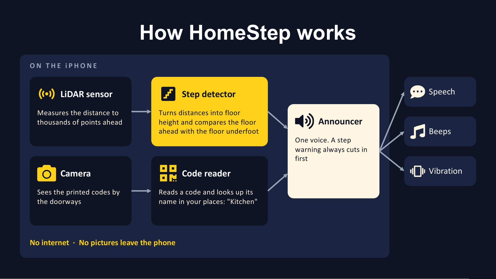

# HomeStep

HomeStep is an iPhone app that helps visually impaired people get around indoors. The phone clips onto a walking stick. It warns about steps and obstacles before you reach them, and reads printed codes by the doorways to tell you where you are.

I built it for my grandfather. He has lost about ninety percent of his sight, and at home he had three problems: he lost his way (some mornings he ended up at a console table he thought was the kitchen counter), he could trip on the step down into our sunken living room or the step back up, and he bumped into things.

**HomeStep works with the walking stick. It doesn't replace it.**

> **This is the `spec-driven` branch.** The decision logic has been moved into a Swift package with its own tests, and the project now has a PRD, numbered requirements, specs, a hazard analysis and field protocols ([`docs/`](docs/README.md)). A side-by-side review found no change in behaviour from the build on the phone, but this version **has not been run on the phone yet**. The build that was tested at home is on [`main`](../../tree/main).

<p align="center">
  
  &nbsp;
  
  &nbsp;
  
</p>

**Demo:** [docs/media/homestep-demo.mp4](docs/media/homestep-demo.mp4), 54 seconds. On the left is the walk; on the right is the phone screen. In order you'll hear "Proceed" on clear floor, "Step up", "Front door" from a printed code, "Obstacle ahead" with its beep, "Step down", and "Kitchen" from another code.

## What it does

- **Steps.** On iPhones with LiDAR (the Pro models), HomeStep watches the floor about a stride ahead. When it drops, a double beep starts and gets faster as you get closer, then it says "Step down." When the floor rises it says "Step up." No setup or codes are needed for this.
- **Obstacles.** Something in the way, like a chair, gives a single lower beep that speeds up as you get closer, and "Obstacle ahead" the first time.
- **Where you are.** You add your home in the app, name the spots, and print a code for each one. Tape each code about a stride before its spot. When the camera sees one, HomeStep says its name, like "Kitchen." A code can also mark a step, so a marked step is caught twice: by its code and by LiDAR.
- **"Proceed."** On clear floor, while you're walking, it says "Proceed" every few seconds, so silence never has to mean "clear".
- **Where am I?** A button, or the iPhone's Action button, repeats the last place it read.
- **Settings.** You choose what you hear. Step warnings always play, whatever the settings say. There's a developer mode that shows the live numbers and records test walks, and a "See what HomeStep sees" screen that draws what the detector is looking at over the live camera, so you can set the app up for your house and the steps you have.
- **It never goes quiet without saying so.** If the camera stops (the phone locks, a call comes in, it gets too hot), it says "Guidance stopped. Use your cane."

Everything runs on the phone. HomeStep makes no network connections, and no pictures leave the phone.

## How it works



The rules live in a Swift package, `Core/`, which has no iOS-only code and is tested on any Mac. The app in `Sources/HomeStep/` connects those rules to ARKit, Vision, audio and the screen.

| File | What it does |
|---|---|
| `Core/Sources/HomeStepCore/StepDetector.swift` | The step and obstacle detector |
| `Core/Sources/HomeStepCore/Announcer.swift` | What is said, beeped and buzzed, and when; step warnings first |
| `Core/Sources/HomeStepCore/Place.swift`, `PlaceStore.swift` | Places, landmarks and the code format, saved on the phone |
| `Core/Sources/HomeStepCore/GuideRules.swift` | Spoken messages, the aim check, noticing when the camera stops |
| `Sources/HomeStep/ReflexLayer.swift` | Passes each LiDAR frame to the detector |
| `Sources/HomeStep/MarkerLayer.swift` | Reads the printed QR codes with Apple's Vision framework |
| `Sources/HomeStep/Announcer.swift` | Plays the announcer's decisions |
| `Sources/HomeStep/GuideController.swift` | Runs a session: owns ARKit and passes frames along |
| `Sources/HomeStep/MarkerSheet.swift`, `VisionView.swift` | The printable code sheets; "See what HomeStep sees" |
| `tools/analyze-log.py` | Summarizes a recorded test walk |

### The hard part: a swinging stick

My first version used LiDAR the simple way: a step down looks like the floor suddenly getting farther away, so warn when that distance jumps. That works if you hold the phone still. But a walking stick swings, and every swing tilted the phone enough to change the distance by more than a whole step, so the app kept warning about its own movement.

The fix has two parts. First, HomeStep measures height instead of distance. The iPhone always knows which way is down, so each LiDAR point is turned into a height above the floor, and tilting the phone doesn't change the floor's height. Second, it compares two strips of floor from the same frame: the floor just ahead of the stick and the floor a little further out. Since both come from the same frame, any error in the phone's position moves both by the same amount and cancels out. Fast swings blur the depth image, so then a step has to show up in a few more frames before it's announced.

The threshold came from data. In developer mode the app records what it measures several times a second, and a MARK WRONG button stamps the log when a warning is wrong. On flat floor, the measured drop stayed within about half a centimetre. Our step is about seventeen centimetres. So the warning triggers at seven.

## Testing

- **On the phone, at home.** Using the live 3D view, I tested ten scenes: flat floor, five step-downs (including one at an angle and one next to an obstacle), a step up, and three obstacles. It caught all of them and stayed quiet on flat floor.
- **Recorded walks.** `tools/pull-logs.sh` copies test-walk logs off the phone and `tools/analyze-log.py` reports the flat-floor noise against the size of the real step.
- **Core tests** (`Core/Tests`, about 100) check every rule in [`docs/requirements.md`](docs/requirements.md) that can be checked without a phone. For the detector, a synthetic room is rendered into LiDAR-style depth frames (floors, steps, furniture, gaps with no return) and walked through frame by frame with the cane sweeping.
- **App tests** check the printed sheets, and a UI test walks through first launch and setting up a place.
- **Traceability.** Every requirement is tied to a test, a check, a field protocol or an inspection item; `tools/trace.py` fails the build if one isn't. See [`docs/traceability.md`](docs/traceability.md).

The simulated walks found one real issue, which also applies to the build on the phone: with the warn distance set to 0.30–0.40 m, a step beeps but is never named. The default, 0.45 m, is fine. It's tracked as KI-1 in [`docs/specs/step-detector.md`](docs/specs/step-detector.md#known-issues) and will be settled at the real step.

**Not done yet:** a formal trial of ten approaches in each direction at the real step, plus ten with the step's code covered so only LiDAR can catch it. Informal walks catch the step from both directions, but until that trial is run I don't claim more than that.

## Build it

You need a Mac with a recent Xcode and [XcodeGen](https://github.com/yonaskolb/XcodeGen) (`brew install xcodegen`). Steps and obstacles need a LiDAR iPhone (iPhone 12 Pro or later Pro model); the Simulator runs the app but has no camera or LiDAR.

```sh
cp Config/Signing.example.xcconfig Config/Signing.xcconfig   # add your Team ID to run on a phone
xcodegen generate
open HomeStep.xcodeproj
```

Tests:

```sh
make test-core   # the rules and the simulated walks; no Simulator needed
make check       # no networking code, privacy, tool tests, traceability
make test-app    # app tests and the UI test in the Simulator
make test        # all of the above
```

## Built with

Swift and SwiftUI in Xcode, ARKit for LiDAR depth, Vision for reading the codes, AVFoundation and Core Haptics for sound and vibration, and Python for analyzing test logs.

## Safety

HomeStep is an extra warning, not a mobility aid on its own. It can miss a step or an obstacle in poor light, on shiny or dark floors, or when the phone is aimed wrong. It isn't a medical device and isn't for outdoor or street use. Keep using your cane or guide dog, and never rely on it in an emergency.

## License

MIT. See [LICENSE](LICENSE).
