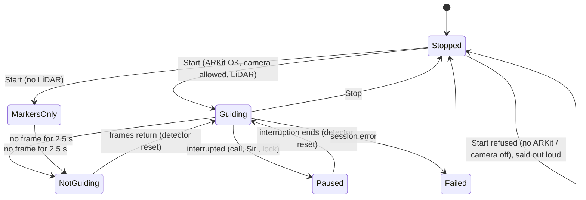

# Spec: guiding session

**Code:** `Sources/HomeStep/GuideController.swift`; rules in `Core/Sources/HomeStepCore/GuideRules.swift`.
**Tests:** `Core/Tests/HomeStepCoreTests/GuideRulesTests.swift`; on the phone, `docs/testing/field-protocols.md`.
**Requirements:** REQ-GUIDE-*, REQ-SAFE-04, REQ-STEP-09, REQ-STEP-10.

## States

| Change | Said | Screen |
|---|---|---|
| Start, with LiDAR | "Guiding. *place*." or "Guiding. Watching for steps and obstacles." | Guiding |
| Start, no LiDAR | "Step detection needs a LiDAR iPhone. Reading markers only. Use your cane." | Markers only |
| Start, no ARKit | "This phone does not support HomeStep's camera tracking." | This iPhone can't run HomeStep. |
| Start, camera off | "HomeStep needs the camera. Turn on camera access in the Settings app." | Camera access is off… |
| Start, Low Power Mode | also "Low power mode is on." | |
| No frames for 2.5 s | "Guidance stopped. Use your cane." (once) | NOT GUIDING |
| Frames return | "Guidance resumed." | Guiding |
| Interrupted | "Guidance paused. Use your cane." | PAUSED |
| Interruption ends | "Guidance resumed." | Guiding |
| Session error | "Guidance failed. Use your cane." (after stopping) | GUIDANCE FAILED |
| Place changed while guiding | "Now using place *name*." or "No place in use. Markers are off." | |

Start also resets the detector and the monitors, runs ARKit with a gravity-aligned world and LiDAR depth when available, keeps the screen awake, and begins a recording in developer mode. Stop pauses ARKit, silences everything (including queued beeps), clears STOP BEEPING and lets the screen sleep.

## Every frame (camera thread)

1. Note the time, for the stall check.
2. If the frame has depth, run the detector; send any event to the announcer; log every event except `clear` with its numbers; publish the numbers to the screen and log about 8 times a second.
3. Read codes in the frame and announce any that belong to the place in use. This happens with or without depth.

## Every second (main thread)

1. **Stall check:** see the table above.
2. **Aim check** (with LiDAR, not stalled): if the reference strip has fewer than 12 points on 3 checks in a row, say "Cannot see the floor. Tilt the phone down.", at most every 12 s.

## Aim hint on screen

| Condition (checked in order) | Shown |
|---|---|
| no reading yet | Waiting for depth… |
| tilt under 25° | TILT DOWN — aiming too flat (n°) |
| tilt over 58° | TILT UP — aiming too steep (n°) |
| reference strip under 12 points | Can't see the floor underfoot — tilt down |
| probe strip under 12 points | Can't see the floor ahead — tilt up |
| otherwise | Aim OK (n°) |

## Where am I?

From the button, the Action button, Shortcuts or Siri: "Last marker: *name*, just now / a minute ago / *n* minutes ago." or "No marker read yet." ("HomeStep is stopped. No marker read yet." when stopped).
