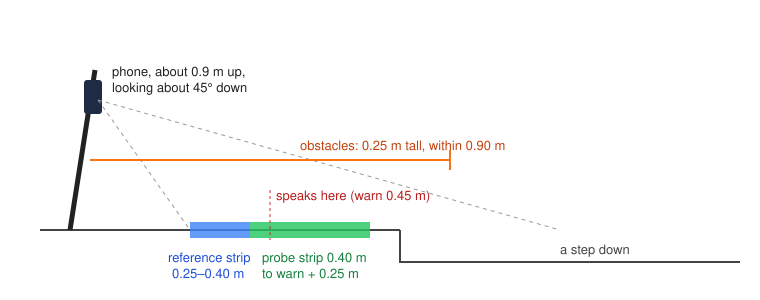

# Spec: step and obstacle detector

**Code:** `Core/Sources/HomeStepCore/StepDetector.swift` (rules), `Sources/HomeStep/ReflexLayer.swift` (reads ARKit).
**Tests:** `Core/Tests/HomeStepCoreTests/StepDetectorTests.swift`, `WalkScenarioTests.swift`.
**Requirements:** REQ-STEP-*, REQ-OBST-*, REQ-CLEAR-01, REQ-SAFE-07, REQ-SAFE-08.

## What it gets each frame

| Input | From | Notes |
|---|---|---|
| Depth map | ARKit `sceneDepth.depthMap` | 256 × 192 metres, about 60 times a second |
| Confidence map | ARKit `sceneDepth.confidenceMap` | 0 low, 1 medium, 2 high |
| Camera pose | `frame.camera.transform` | gravity-aligned world: +Y up, units metres |
| Intrinsics | `frame.camera.intrinsics`, scaled from the colour image size to the depth map size | |
| Timestamp | `frame.timestamp` | for sweep rate and walking speed |
| Warn distance | the setting, 0.30 to 0.90 m | how far ahead a step is spoken |

Frames without depth (an iPhone without LiDAR) are not processed; codes are still read.

## What it returns

An optional event, and a `Reading` of the frame's numbers for the screen and the log. Events, in priority order:

1. `step(text, distance, speak)`: "Step down." or "Step up.", the distance to the near edge, and whether it's close enough to speak.
2. `proximity(distance, intensity)`: an obstacle and how close it is.
3. `clear`: walking, nothing in the way.
4. nothing.

## The geometry



```
camera ● (about 0.9 m up, looking about 45° down)
        \
         \           reference      probe strip
          \          strip          (step decision)
   ________\_______|--------|---------------------|_________
   floor           0.25     0.40                  warn + 0.25 m ahead
```

For every second pixel in each direction:

1. Skip readings that aren't finite, are nearer than 0.1 m or farther than 5 m, or have confidence below medium.
2. Turn the pixel into a world point using the intrinsics and the camera pose.
3. Measure **ahead** along the walking direction, which is the camera's view flattened onto the floor, and **sideways** from the walking line. Keep points with ahead between 0 and max(warn + 0.25, 0.90) m, and sideways within 0.35 m.
4. A point at least 0.35 m below the camera is ground. Ground from 0.25 to 0.40 m ahead goes in the **reference strip**; ground from 0.40 m to warn + 0.25 m goes in the **probe strip**.
5. Any point within 0.90 m ahead is an obstacle **candidate**, at any height.

## The decision

Let *ref* be the median height of the reference strip and *low15* the 15th percentile of the probe strip. A strip with fewer than 12 points gives no height.

**Obstacle.** The nearest candidate more than 0.25 m above *ref* (or above the probe's median, if there is no *ref*), held for 3 frames in a row. With no floor at all, nothing is decided.

**Step down.** If *ref* exists and the probe has at least 12 points: the share of probe points more than 0.07 m below *ref* is at least 15%. The edge is the nearest of those points.

**Step up.** Otherwise, if the share more than 0.07 m above *ref* is at least 60%, and the probe's median minus *ref* is between 0.07 and 0.22 m. The edge is the nearest raised point.

**Floor vanished.** If *ref* exists, the probe has fewer than 12 points and no obstacle is confirmed: step down, at 0.40 m.

**Confirmation.** The same direction must hold for 3 frames in a row, or 5 if the camera turned faster than 60° a second since the last frame. A change of direction restarts the count. Then the step is reported, with `speak` true once the edge is within the warn distance.

**Otherwise** an obstacle is reported if there is one, or `clear` if the walker is moving at 0.10 m/s or more (median of the last 20 frames) and the reference strip has at least 12 points.

## Why it's built this way

- **Height, not distance (REQ-STEP-01).** The first version compared the distance along a downward ray with an expected floor distance. On a swinging stick, the swing changed that distance by more than the step being looked for, and it warned about its own movement. Height in the gravity-aligned world doesn't change when the phone tilts.
- **Same frame (REQ-STEP-02).** The next version compared the probe with a floor height remembered over the last second. ARKit's position estimate wobbles by a couple of centimetres while walking, which showed up as false drops in normal gait. Both strips from one frame share the same error, so it cancels.
- **One probe strip.** A version with a separate look-ahead band said "Step down" when a chair hid the floor behind it. One strip can't be fooled that way. The price is a shorter warning distance, which is why it's adjustable.
- **Coverage, not average.** The sweep often shows only part of an edge in a frame. Averaging would water the edge down; the minimum would fire on one bad reading. A share of the strip catches a partial edge while ignoring scattered noise. Step up asks for a much larger share (60%) because a chair seat is a raised patch, not a raised floor.

## Measured behaviour

From the logged walk at home: on level floor the measured drop stayed within about 0.005 m; the threshold is 0.07 m; the real step is 0.173 m. The only step warnings in that walk were at the real step, from both directions.

From the synthetic walks (camera 0.92 m up, 45° down, 0.5 m/s, sweeping 15° each side once a second), at the default 0.45 m warn distance:

| Approach | Beeping starts | Words |
|---|---|---|
| 0.17 m step down | about 0.52 m before the edge | about 0.38 m before |
| 0.17 m step up | about 0.47 m before | about 0.47 m before |

## Known issues

### KI-1: short warn distances only beep

Once the edge is within about 0.3 m of the phone, it falls inside the reference strip: the "floor underfoot" is then partly the lower floor, and the step is no longer reported. In the synthetic walks, with the warn distance at 0.30, 0.35 or 0.40 m, the edge reaches that point before it is close enough to be spoken, so the step **beeps but is never named**. From 0.45 m (the default) up, it is spoken.

This also applies to the phone build (1.1.0), where Settings allows 0.30 m and up. Until it is checked at the real step with protocol FP-1, keep the warn distance at 0.45 m or more. Likely fixes, to be decided by the field data: raise the minimum setting to 0.45 m, or keep reporting a step whose edge has entered the reference strip. `WalkScenarioTests.testEveryAllowedWarnDistanceSpeaks` records this as an expected failure (REQ-STEP-16).

### KI-2: a hole that starts inside the probe strip

The "floor vanished" rule needs the probe strip to be nearly empty. If floor is visible for the first few centimetres of the probe strip and then returns nothing, with no low points seen, nothing is reported. A real drop usually shows its lower floor, which the step-down rule catches; a drop into darkness or onto a surface the LiDAR can't see may not.

### KI-3: geometry assumptions

The synthetic tests assume a camera about 0.92 m up and pitched about 45°, matching the tested mount. A different mount changes where the strips land on the floor. The aim hint and the "Cannot see the floor" warning cover the worst cases; the field protocols are the real check.
